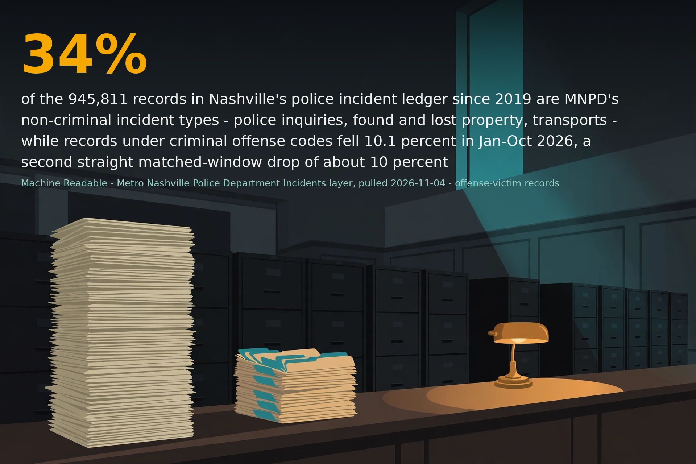
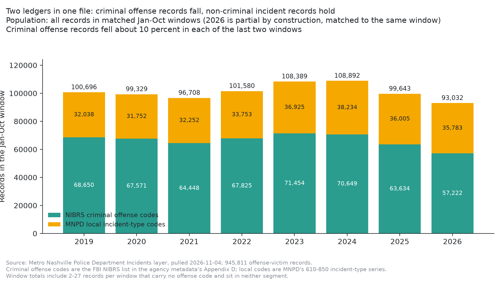
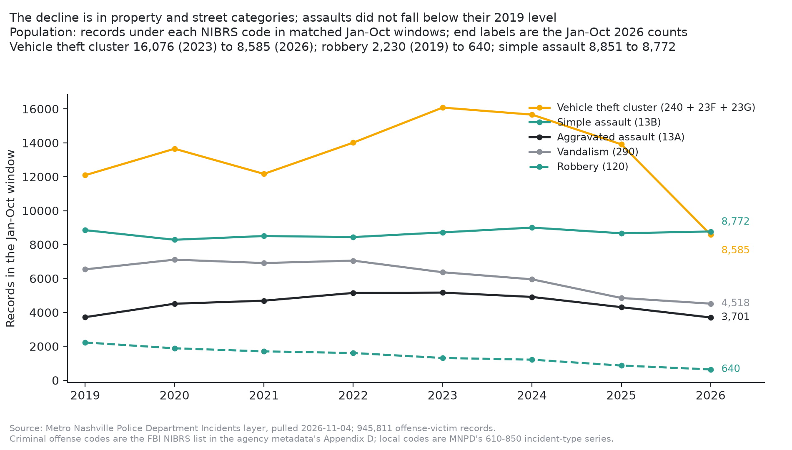
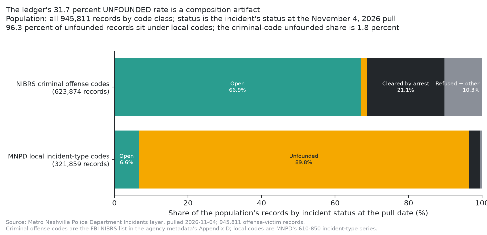
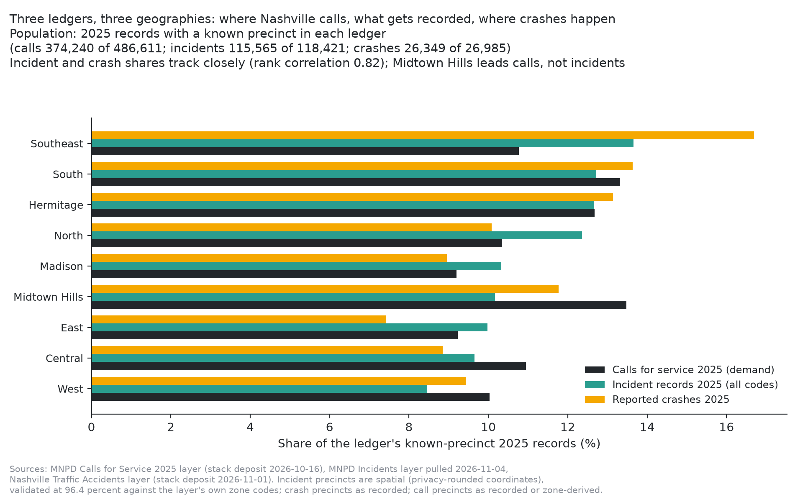

# Nashville Police Incidents: a third of the ledger is not crime, and the crime side fell about 10 percent twice

**One line:** Of the 945,811 records in Nashville's police incident ledger since 2019, 34.0 percent sit under MNPD's own non-criminal incident-type codes. Records under criminal offense codes fell 9.9 percent in Jan-Oct 2025 and another 10.1 percent in Jan-Oct 2026, carried by vehicle break-ins, vehicle theft and robbery, while assaults stayed flat at their 2019 level.

The findings in full are in [brief-draft.md](brief-draft.md); the pull, the audit, and the independent verification are in [verification.md](verification.md) and [verification-ledger-independent.md](verification-ledger-independent.md); the headline numbers live in [stats.json](stats.json); source detail is in [sources.md](sources.md).

## Findings

- **F1 - Composition.** 321,859 of 945,811 records (34.0 percent) sit under MNPD local incident-type codes (the 610-850 series the agency metadata appends after the NIBRS list). Code 740 alone - POLICE INQUIRY (185,355) plus TRANSPORT (19,825) - is 205,180 records, 21.7 percent of the ledger. The local share of each full year rose from 31.8 percent (2019) to 36.1 percent (2025).
- **F2 - Trend.** Criminal offense records fell 11.7 percent between full years 2023 and 2025 (85,651 to 75,641), and in matched Jan-Oct windows fell 9.9 percent (2024 to 2025) and 10.1 percent (2025 to 2026): 71,454 to 63,634 to 57,222. The combined-ledger decline (8.7 percent, full years) understates the criminal-side decline because local-code records grew 12.3 percent from 2019 to 2025.
- **F3 - Categories.** Jan-Oct vehicle cluster (240 + 23F + 23G): 16,076 (2023) to 8,585 (2026), -46.6 percent. Robbery: 2,230 (Jan-Oct 2019) to 640, -71.3 percent. Vandalism and burglary each -30.9 percent against 2019 windows. Simple assault flat (8,851 to 8,772, -0.9 percent); aggravated assault back to its 2019 level after a 2023 peak; intimidation +36.1 percent; drug violations up against 2023 (35A +16.3 percent, 35B +18.8 percent).
- **F4 - Status.** The ledger-wide UNFOUNDED share is 31.7 percent, but 96.3 percent of unfounded records sit under local codes (unfounded share 89.8 percent there). Within criminal codes: unfounded 1.8 percent, open 66.9 percent, cleared by arrest 21.1 percent. Status is a pull-date snapshot; recent years are right-censored and are never compared as performance.
- **F5 - Offenses vs crashes, 2019-2025.** Precinct shares of criminal offense records (spatial) and reported crashes (recorded) track with rank correlation 0.80; no precinct differs by more than 2.3 points. North (+2.3) and East (+2.2) run offense-heavy; Midtown Hills (-1.6) and South (-1.2) run crash-heavy. Shares, not risk: no exposure denominator is applied.
- **F6 - The 2025 triad and the calls join.** 94.9 percent of the 72,041 distinct complaint numbers on 2025 calls match an incident in this layer; 67.2 percent of the 98,930 incidents that occurred in 2025 have a linked call. Only 15.2 percent of calls carry a complaint number. Geographically the calls ledger diverges (rank correlation against incidents 0.32): Midtown Hills leads calls (13.5 percent) but not incidents (10.2 percent); Southeast reverses (calls 10.8, incidents 13.7, crashes 16.7 percent).

## Charts

- 
- 
- 
- 

## Files

- `brief-draft.md` - the brief itself (findings, labeled interpretation, who can act, data notes).
- `stats.json` - every headline figure the brief states, with definitions.
- `sources.md` - source services, snapshots, and the deposits fused against.
- `verification.md` - source verification, methods checklist, the Section 10 pre-flight audit output, trap dispositions, and the sync gate.
- `verification-ledger-independent.md` - the independent verifier's ledger (server-side aggregates, pyarrow recount, independent polygon code).
- `reviewer-notes.md` - self-review: definitions, framing risks, what a reviewer should press on.
- `social-drafts.md` - LinkedIn draft, held for a Friday synthesis per the standing cadence rule.
- `hero-headline.txt`, `hero_source/` - the hero's text and source illustration; `hero.png` is the composite.
- `code/` - `pull_data.py`, `pull_boundaries.py`, `build_stats.py`, `audit_section10.py`, `verify_independent.py`, `charts.py`, `hero_composite.py`.
- `data/` - pull log, boundary log, the archived agency metadata PDF, analysis panels (year, category, fusion, triad, status, ZIP), audit and verifier outputs.

## Data and license

Cleaned layer: Nashville stack deposit `mnpd_incidents` (cleaned parquet in the stack, raw snapshot preserved with SHA-256). Data: Metro Government of Nashville and Davidson County / MNPD open data. Brief text and analysis: CC-BY-4.0 (see LICENSE).
